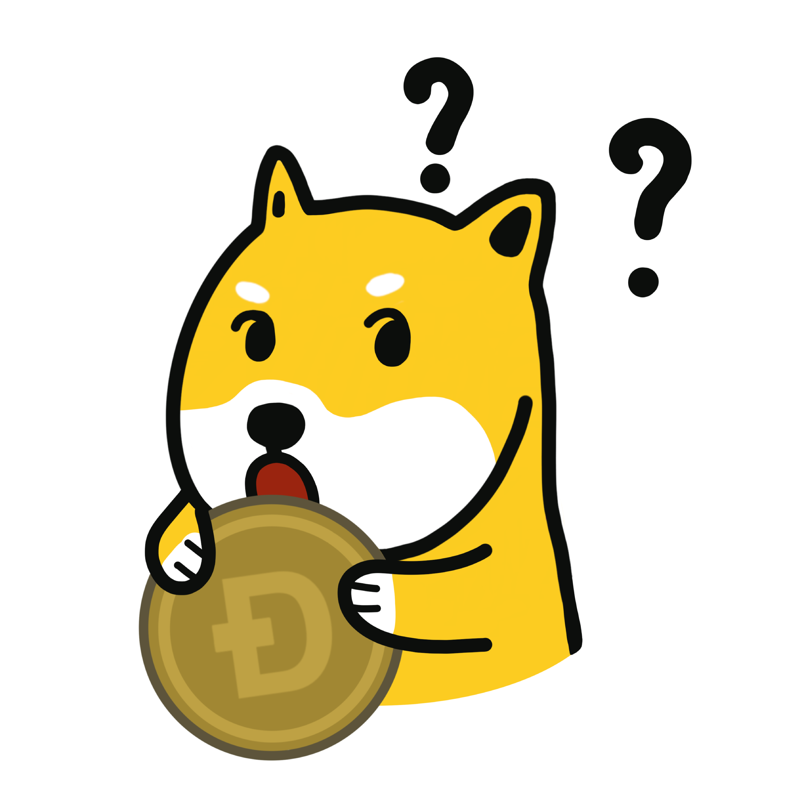

+++
title = "ドージコインとは？"
date = "2021-10-22"
type = "article"

[ author ]
  name = "ドージコイン"
+++
 

ドージコインは、人によってさまざまな姿を見せます。その中心にあるのは、人々を笑顔にする、偶然から生まれた暗号通貨の**ムーブメント**です！

同時にドージコインは、[ブロックチェーン技術](https://www.dogecoin.com/dogepedia/articles/what-is-a-blockchain)を活用したオープンソースのP2P暗号通貨でもあります。ブロックチェーンとは、[ノード](https://www.dogecoin.com/dogepedia/articles/what-is-a-node)と呼ばれるコンピューターのネットワークによって維持される、情報を公開台帳として記録するための、非常に安全な分散型のしくみです。

しかし、それ以上に大切なのが、[ドージコイン・マニフェスト](https://foundation.dogecoin.com/manifesto/)にまとめられたドージコインの精神と、あなたと同じような気さくな人たちが集まってできた、すばらしく活気のあるコミュニティです！

ドージコインのコミュニティが大切にしているのは、お互いを支え合うこと、親切であること、暗号通貨について人に教えること、寄付を集めること、楽しむこと、ミームを作ること、そしてばかばかしくあることです。それは、ドージコインの非公式なキャッチフレーズにうまく言い表されています。**D**o **O**nly **G**ood **E**veryday（毎日、ただ良いことだけをしよう）。

さらにドージコインのコミュニティは、従来の法定通貨に代わる実用的で正当な通貨として、ドージコインを広めることに情熱を注いでいます。そのためドージコインのエコシステムは、動的かつ有機的な形で広がり続けており、「最も楽しい暗号通貨」という原点に忠実であり続けながら、人々による、人々のための、広く使われる通貨になることを目指しています。

その根っこにあるドージコインは、役に立ち、親しみやすく、あたたかく迎え入れてくれて、そして信頼できる存在です。あなたがここに来てくれたことを、私たちはとてもうれしく思っています。
